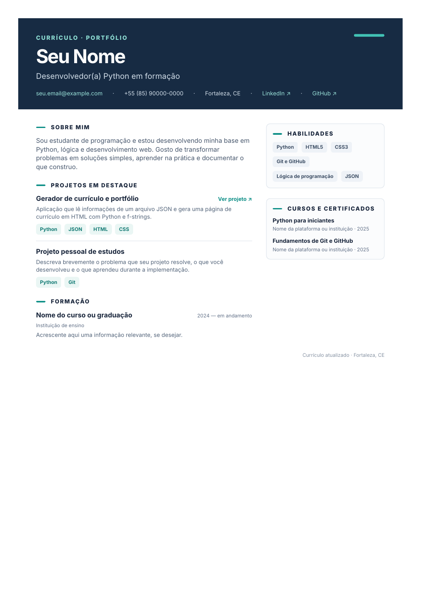

# Gerador de currículo e portfólio em HTML

Projeto em Python que lê os dados de `dados.json` e gera um currículo/portfólio em `index.html`. A página usa HTML e CSS responsivos e inclui regras `@media print` para impressão em papel A4.

## Prévia



> **Antes de publicar:** os dados de `dados.json` são apenas exemplos. Troque nome, contatos, formação, cursos, habilidades e projetos pelas suas informações reais. Confira também os links para não publicar dados de exemplo.

## Requisitos

- Python 3.8 ou superior
- Nenhuma biblioteca externa (o script usa apenas a biblioteca padrão do Python)

## Como gerar a página

1. Edite o arquivo `dados.json` com seu conteúdo.
2. Abra o terminal nesta pasta.
3. Execute:

   ```bash
   python gerar.py
   ```

4. Abra o arquivo `index.html` no navegador. Sempre que alterar o JSON, execute o script novamente.

## Como salvar em PDF

1. Abra `index.html` no Chrome, Edge ou Firefox.
2. Use `Ctrl + P` (Windows/Linux) ou `Cmd + P` (macOS).
3. Escolha **Salvar como PDF**.
4. Se disponível, ative a opção de imprimir gráficos/cores de fundo para preservar o cabeçalho.

O CSS contém `@page` e `@media print` com tamanho A4, margens compactas e ajustes de tipografia para caber em uma página. A quantidade final de páginas pode variar conforme o tamanho dos textos adicionados; revise a prévia de impressão e encurte os conteúdos se necessário.

## Estrutura do projeto

```text
gerador-portfolio/
├── dados.json          # Informações que você personaliza
├── gerar.py            # Lê o JSON e monta o HTML com f-strings
├── index.html          # Página gerada pelo script
├── print-da-pagina.png # Captura da página no navegador
└── README.md           # Este guia
```

## Personalização

O JSON está organizado em cinco partes:

- `perfil`: nome, título profissional, localização e contatos;
- `habilidades`: lista de tecnologias e competências;
- `formacao`: curso, instituição, período e detalhes;
- `cursos`: cursos complementares e certificados;
- `projetos`: nome, descrição, tecnologias e link.

Para adicionar itens, copie um objeto existente dentro da lista correspondente, mantendo a sintaxe JSON (aspas duplas e vírgulas entre os itens).

## Publicação

A publicação não faz parte deste projeto: depois de personalizar e testar a página, você pode criar seu repositório no GitHub e habilitar o GitHub Pages nas configurações do repositório.
